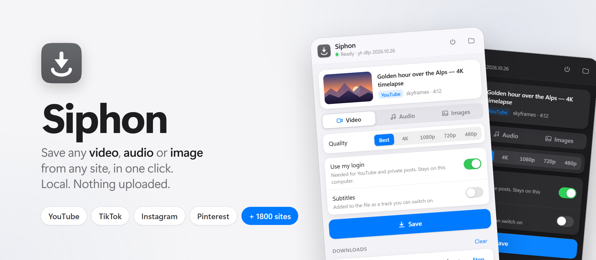
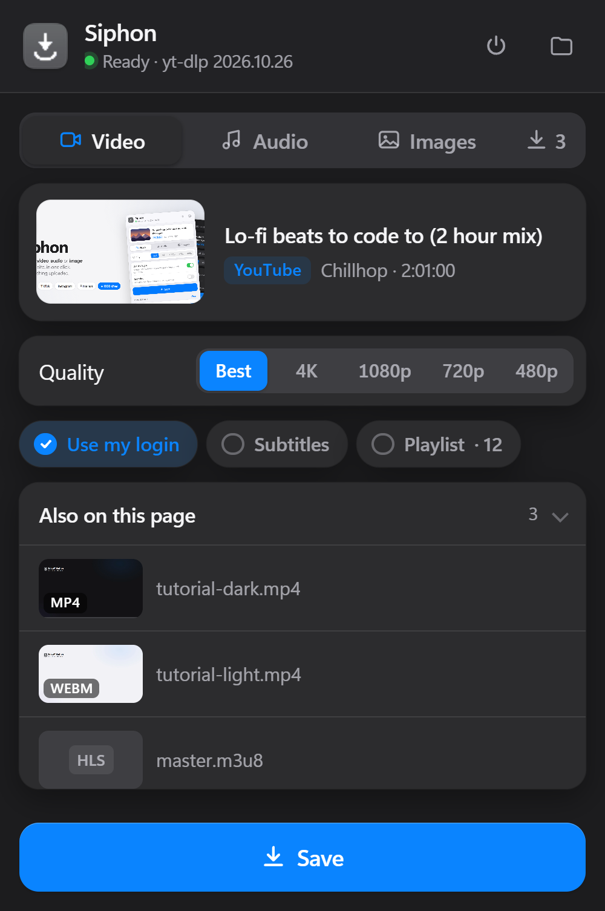
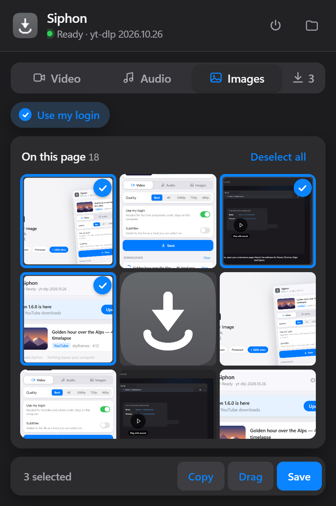
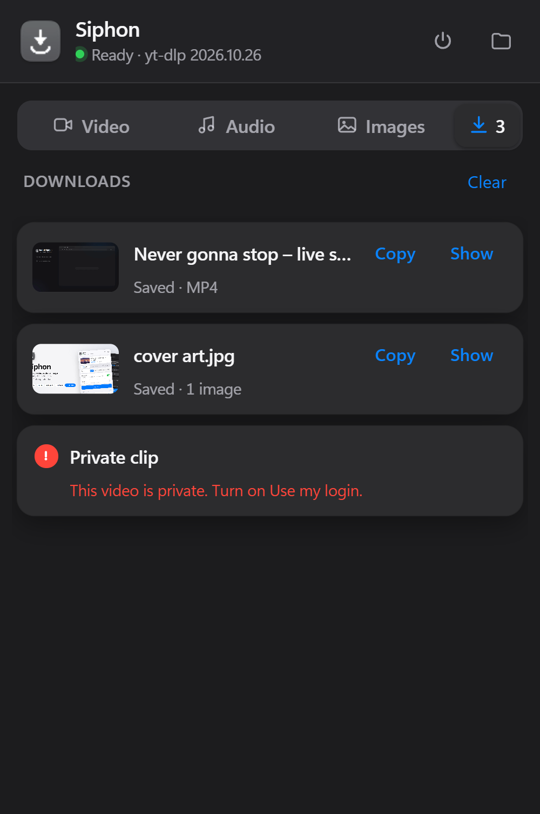
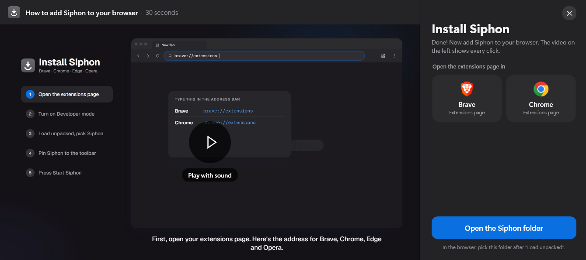
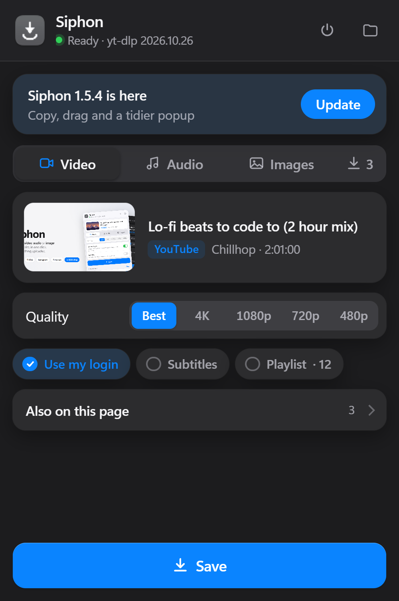

<p align="center">
  
</p>

<p align="center">
  <a href="https://github.com/aywalh/siphon/releases/latest"></a>
  <a href="https://github.com/aywalh/siphon/releases"></a>
  
  
</p>

<h3 align="center">
  Videos, Musik und Bilder von jeder Seite speichern – mit einem Klick, direkt auf deinem PC.<br>
  <a href="https://github.com/aywalh/siphon/releases/latest/download/Siphon.zip">⬇️ Siphon.zip herunterladen</a>
</h3>

---

## ✨ Was Siphon kann

- 🎬 **Videos** in bis zu 4K. YouTube, TikTok, Instagram, Pinterest, X, Reddit, Twitch, Vimeo, Facebook und über 1800 weitere Seiten.
- 🎵 **Audio als MP3** mit Cover und Titel. Ideal für Musik, Podcasts, SoundCloud und Bandcamp.
- 🖼️ **Bilder** in der größten Auflösung, die eine Seite hat. Ein Klick wählt aus, dann **Save**, **Copy** oder **Drag**.
- 📋 **Copy & Drag:** Fertige Downloads mit **Copy** kopieren und mit Strg+V einfügen. Oder Bild bzw. Titel einfach direkt aus dem Popup in Discord, einen Chat oder einen Ordner ziehen.
- 👀 **Vorschau:** Videos auf der Seite und deine Downloads zeigen ein Vorschaubild. Beim Drüberfahren läuft eine große Vorschau, ohne Ton.
- 📸 **TikTok-Fotoposts** werden zu einem Video mit Ton.
- 🖱️ **Rechtsklick** auf ein Video, Bild oder Audio → *Siphon this …*. Das Popup brauchst du dafür nicht.
- 🔐 **Private Inhalte**, die du selbst sehen darfst, zum Beispiel Videos mit Altersgrenze. Dafür nutzt Siphon deinen Login aus dem Browser.
- 🔄 **Updates mit einem Klick** direkt im Popup.

## 🖥️ So sieht es aus

<p align="center">
  &nbsp;
  &nbsp;
  
</p>

Öffne eine Seite mit einem Video und klick auf das Siphon-Symbol. Dann wählst du **Video**, **Audio** oder **Images**, stellst die Qualität ein und klickst auf **Save**. Fertig.

Im Tab **⬇** siehst du deine Downloads. Von dort kopierst du sie mit **Copy** oder ziehst sie direkt raus.

Die Dateien landen in **`Downloads\Siphon`**.

## 📦 Installation (einmalig, ca. 3 Minuten)

1. **[Siphon.zip herunterladen](https://github.com/aywalh/siphon/releases/latest/download/Siphon.zip)** und entpacken.
   Leg den Ordner an einen festen Platz, zum Beispiel `Dokumente\Siphon`. Er bleibt dort, denn der Browser lädt Siphon direkt aus diesem Ordner.
2. Im Ordner **`INSTALL.bat`** doppelklicken. Es öffnet sich ein Fenster:
   - **Links** läuft ein 30-Sekunden-Video, das jeden Klick zeigt. Erst ohne Ton; mit dem ▶ in der Mitte startet es von vorn mit Ton.
   - **Rechts** auf **Install** klicken. Siphon richtet alles ein, was fehlt: Python, ffmpeg, yt-dlp, gallery-dl und deno.
3. Fertig? Dann erscheinen rechts Kacheln für jeden Browser auf deinem PC (Brave, Chrome, Edge, Opera, Vivaldi).
   Ein Klick öffnet direkt die Erweiterungsseite des Browsers. Dort den **Entwicklermodus** einschalten, auf **Entpackte Erweiterung laden** klicken und den **Siphon**-Ordner auswählen.
   Den Ordner zeigt dir der Knopf **Open the Siphon folder**.
4. Siphon in der Symbolleiste anpinnen (🧩 → 📌), das Popup öffnen und auf **Start Siphon** klicken.

<p align="center"></p>

<details>
<summary>Kein Fenster? So geht es von Hand</summary>

Im Ordner `Siphon\helper` die Datei `install.bat` doppelklicken. Sie macht dasselbe in einem Konsolenfenster. Die Erweiterungsseite findest du unter `brave://extensions`, `chrome://extensions`, `edge://extensions` oder `opera://extensions`.

</details>

> [!TIP]
> Windows SmartScreen meldet „Der Computer wurde durch Windows geschützt“? Klick auf **Weitere Informationen** und dann auf **Trotzdem ausführen**. Das kommt, weil `INSTALL.bat` nicht signiert ist.

## 🔄 Updates

<p align="center"></p>

Gibt es eine neue Version, zeigt das Popup oben **Update**. Ein Klick genügt: Siphon lädt die neue Version von hier, prüft sie und ersetzt die alten Dateien. Dabei bringt es auch yt-dlp & Co. auf den neuesten Stand und startet sich neu.

Laufende Downloads lass vorher fertig werden. Deine Einstellungen und deine Dateien bleiben erhalten.

## 🛟 Wenn etwas nicht geht

| Problem | Lösung |
|---|---|
| Popup zeigt **Siphon is off** | Auf **Start Siphon** klicken. Klappt das nicht, `INSTALL.bat` nochmal ausführen. |
| Eine Seite wird nicht erkannt | Seite neu laden (F5) und es nochmal versuchen. Oder Rechtsklick direkt aufs Video → *Siphon this video*. |
| YouTube / TikTok geht plötzlich nicht mehr | Das liegt meistens an einer Änderung auf der Seite. Auf ein Update warten oder `INSTALL.bat` nochmal ausführen, das holt das neueste yt-dlp. |
| Privates Video geht nicht | Im Popup **Use my login** einschalten und auf der Seite eingeloggt sein. |
| Status zeigt **no ffmpeg** | `INSTALL.bat` nochmal ausführen und den Browser einmal neu starten. |
| Ordner verschoben | `INSTALL.bat` im neuen Ordner ausführen und die Erweiterung neu laden. |
| Symbol zeigt rotes **!** nach Rechtsklick | Dort wurde nichts gefunden, oder Siphon ist aus. |

## 🔒 Privatsphäre

- Alles läuft **auf deinem PC**. Es gibt keinen Account, keinen Server und kein Tracking.
- Der Helfer hört nur auf `127.0.0.1` und nimmt nur Anfragen von Browser-Erweiterungen an.
- **Use my login** reicht die Cookies der aktuellen Seite nur an den lokalen Helfer weiter. Er löscht sie nach dem Download wieder.
- Ins Internet geht nur die Anfrage an die Seite, von der du lädst. Dazu kommt höchstens einmal pro Stunde eine Abfrage an GitHub, ob es ein Update gibt.

## 🗑️ Deinstallieren

1. Die Erweiterung auf der Erweiterungsseite deines Browsers entfernen.
2. Im Ordner `Siphon\helper` in der Adresszeile `cmd` eingeben und dann ausführen:
   ```bat
   py register.py --remove
   ```
3. Den Siphon-Ordner löschen.

---

<sub>Dieses Repository enthält nur die Downloads, der Quellcode wird hier nicht veröffentlicht. Siphon nutzt <a href="https://github.com/yt-dlp/yt-dlp">yt-dlp</a>, <a href="https://github.com/mikf/gallery-dl">gallery-dl</a> und <a href="https://ffmpeg.org">ffmpeg</a>. Lade nur Inhalte herunter, die du speichern darfst: Viele Plattformen verbieten das in ihren Nutzungsbedingungen, und die Rechtslage ist je nach Land unterschiedlich.</sub>
